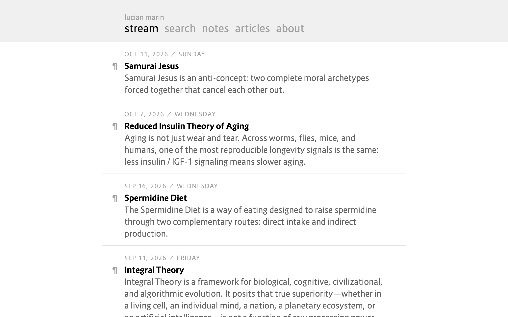

# Fastnote



Note keeping and link sharing built with **FastAPI**, **Jinja2**, **feedparser**, and a single `notes.json` file (a Python/FastAPI port of [instanote](https://github.com/lucianmarin/instanote)).

## Features

- **Flat-File JSON Storage**: Stores all notes in `notes.json` keyed by UTC timestamp (`YYYYMMDDHHMM`), requiring no database server.
- **Unified Stream & RSS Aggregation**: Merges local notes with articles fetched from `https://lucianmarin.github.io/feed.rss` via `feedparser`.
- **Full-Text Search**: Searches across URLs, titles, quotes, and note bodies (`/search?q=`).
- **RSS 2.0 Feed**: Serves the 20 latest combined stream items at `/rss` (`application/rss+xml`).
- **Cookie Authentication**: Protects note creation (`/edit`), editing (`/edit?id=`), and deletion (`/delete/{id}`) using an MD5 password hash stored in `local.py`.

## Routes

- `GET /` — Combined stream of notes and blog articles (10 per page, `?p=1`).
- `GET /notes` — Paginated notes-only stream.
- `GET /articles` — Paginated blog articles stream.
- `GET /{id}` — Permalink view for a single note or article with previous/next navigation.
- `GET /search?q=` — Search notes and articles (up to 20 results with match counts).
- `GET /rss` — Combined RSS feed.
- `GET /about` — About page.
- `GET /login`, `POST /login`, `GET /logout` — MD5 key login and session cookie management.
- `GET /edit`, `POST /edit`, `GET /delete/{id}` — Add, edit, or delete notes (authenticated).

## Setup

1. Install dependencies:
   ```bash
   pip install -r requirements.txt
   ```
2. Ensure `notes.json` is writable:
   ```bash
   chmod +w notes.json
   ```
3. Configure `local.py` with `DEBUG = True` (or `False` in production) and your MD5 password hash:
   ```python
   DEBUG = True
   PASSWORD_HASH = "<md5-hash-of-your-password>"
   ```
4. Run the server:
   ```bash
   python main.py
   ```
   Open `http://127.0.0.1:8000` and log in at `/login`. Production deployments use `note.service` (systemd) and `note.conf` (Nginx).
